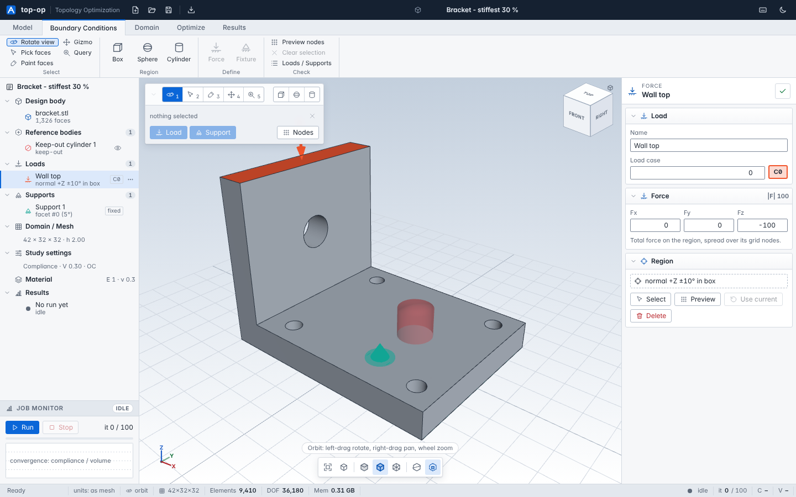
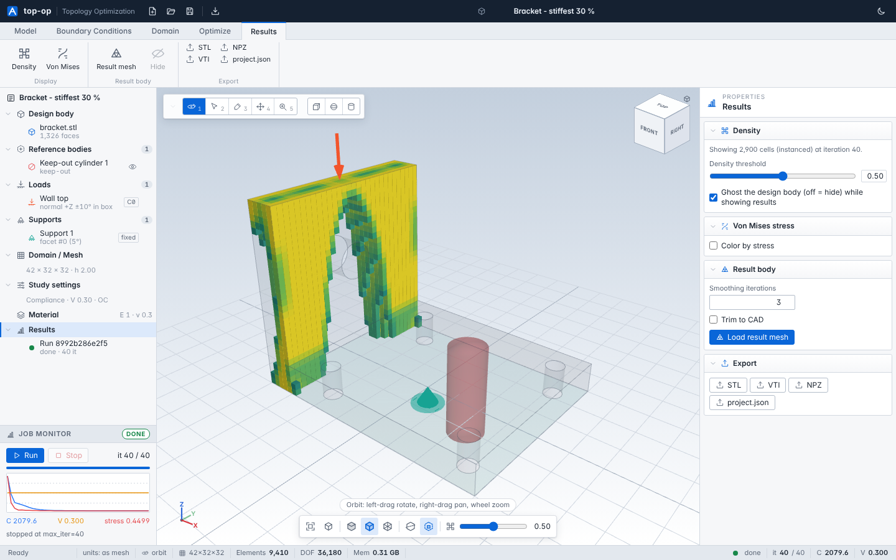
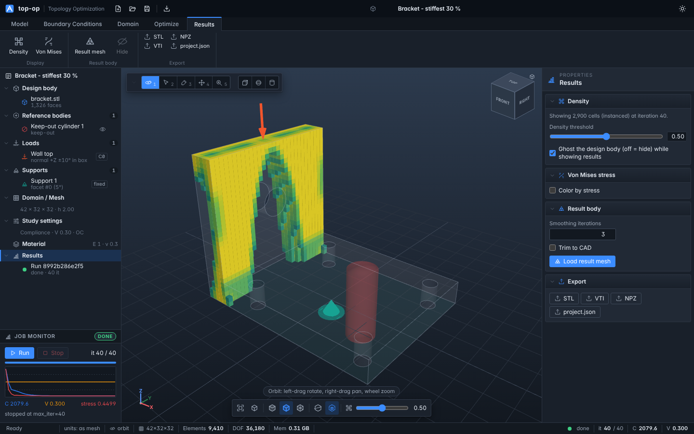

# top-op

[](https://github.com/grint0uc/top-op/actions/workflows/ci.yml)
[](LICENSE)

top-op is a 3D topology optimizer for your own parts. Import an STL (or a STEP file), mark where the
part is held and where it is pushed, say how much material you want to keep, and it removes the rest:
out comes a lighter shape that carries the same loads, as an STL you can print or bring back into CAD.
It uses voxel SIMP (the textbook density method) on the CPU, runs locally with no cloud account, and
has three front ends over the same engine: a browser GUI, a command line for scripted runs, and an MCP
server so Claude can set up and run a study for you.







## Try it in your browser

`lite/` holds **top-op lite**, a single-page version that runs entirely in the browser (no install,
no server): STL import, click-to-select faces for supports and loads, keep-in / keep-out boxes, a
SIMP solver in a Web Worker and STL export. It is limited to about 40 000 elements and has none of
the advanced options below. Open it at <https://claude.ai/artifact/52bTh6bZ9fuH14dxokNY3J>.

## Install

You need [uv](https://docs.astral.sh/uv/) (it fetches Python 3.12+ by itself). Node is only needed
to rebuild the frontend; the built GUI is committed and ships in the package. CI runs on Linux;
macOS and Windows use the same pure-Python package but are not tested in CI.

macOS / Linux:

```
curl -LsSf https://astral.sh/uv/install.sh | sh
git clone https://github.com/grint0uc/top-op
cd top-op
uv sync
uv run topop serve            # open http://localhost:8000
```

Windows (PowerShell):

```
powershell -ExecutionPolicy ByPass -c "irm https://astral.sh/uv/install.ps1 | iex"
git clone https://github.com/grint0uc/top-op
cd top-op
uv sync
uv run topop serve
```

Without cloning, as a command-line tool (puts `topop` on your PATH):

```
uv tool install "git+https://github.com/grint0uc/top-op"
pipx install "git+https://github.com/grint0uc/top-op"
pip install "git+https://github.com/grint0uc/top-op"          # into an active Python 3.12+ venv
```

Optional extras: `step` (STEP import through OpenCascade, about 65 MB) and `accel` (Embree ray
casting). In a clone: `uv sync --extra step`; with pip: `pip install "topop[step] @ git+https://github.com/grint0uc/top-op"`.

## Quick start (GUI)

`uv run topop serve` (or `topop serve` after a tool install), then open http://localhost:8000.
The ribbon tabs follow the workflow:

1. **Model**: import an STL or STEP file (Import, or drop it on the window); `examples/bracket.stl`
   is a good first part. Watertight meshes voxelize best.
2. **Boundary conditions**: select faces (click, shift+click grows a flat face, paint, or a query by
   normal / plane / facet), then add a **Force** (total vector, split over the nodes) or a **Fixture**
   (fixed X/Y/Z). "Preview nodes" shows which grid nodes a selection hits. Supports must stop all
   rigid motion.
3. **Domain**: set the resolution (elements along the longest side; start at 30-40) and check the
   element count and the memory and time estimates. Add reference bodies (STL, box, sphere,
   cylinder) as keep-in (forced solid) or keep-out (forced void, for clearances and bolt access).
4. **Optimize**: volume fraction, penalty, filter radius, iterations, optimizer, symmetry planes,
   stress limit, overhang direction; then Run. The density updates live; Stop keeps the partial result.
5. **Results**: density or von Mises view, iso threshold and smoothing, then export STL (optionally
   trimmed to the CAD surface), VTI (for ParaView), NPZ, or `project.json` to reload or re-run headless.

Projects and runs persist in `~/.cache/topop` (set `TOPOP_DATA_DIR` to move it).

## Headless CLI

```
uv run topop describe examples/bracket.stl                    # bbox + facet table (planes, cylinders/holes)
uv run topop describe examples/bracket.stl --png bracket.png  # plus a preview render
uv run topop run examples/cantilever.json --max-iter 3 --out out/cantilever   # smoke test, ~2 s
uv run topop run examples/bracket.json --out out/bracket      # 40 iterations, ~17 s on 4 cores
uv run topop run examples/bracket.json --symmetry y --trim --out out/sym   # mirror-symmetric, clipped to the CAD
uv run topop run examples/cantilever.json --stress-limit 0.1 --out out/s   # stress-constrained (MMA)
uv run topop struts out/bracket                               # turn the result into round struts
```

A case file is the project JSON with meshes given as file `path`s; see `examples/bracket.json`
(facet support, normal-query load, keep-out slot) and [examples/README.md](examples/README.md).
`topop run` writes `result.stl`, `result.png`, `result.vti`, `density.npz` and `run.json` (which
re-runs as a case). Exit codes: 0 done, 1 failed, 2 invalid case or arguments, 3 out of memory.
Overrides: `--max-iter`, `--resolution`, `--threshold`, `--smooth`, `--optimizer oc|mma`,
`--stress-limit`, `--overhang +z` (write `--overhang=-z` for negative directions),
`--symmetry AXIS[=POS]` (repeatable), `--trim`, `--quiet`. `topop struts` reads a run directory and
writes `struts.stl`, `struts.png` and `struts.json` (`--mode layout|skeleton`; `topop struts --help`).
Every command has `--help`.

## Using it from Claude

Claude does not need the GUI: the MCP server runs headless and Claude Code starts it on demand.
No clone needed, `uvx` fetches and runs it straight from GitHub:

```
claude mcp add top-op -- uvx --from git+https://github.com/grint0uc/top-op topop mcp
```

Other setups:

```
claude mcp add top-op -- uv run --directory /path/to/top-op topop mcp     # from a clone
claude mcp add top-op -- topop mcp                                       # after uv tool / pipx install
```

The MCP server exposes 28 tools covering the whole workflow (`load_mesh`, `describe_mesh`,
`create_project`, `add_load`, `add_support`, `add_ref_model`, `set_params`, `voxel_stats`, `run`,
`result_preview`, `export_stl`, `generate_struts`, ...). Ask something like *"Optimize
examples/bracket.stl: fix the bottom of the plate, push the wall's outer face in +X with 100 N, keep
30 %"* and Claude reads the facet table, picks the faces, smoke-tests and runs. Runs share the data
directory with `topop serve`, so they open in the GUI. Details and pitfalls: [docs/AGENT.md](docs/AGENT.md).

## Features

- Voxel SIMP compliance minimization with the **OC** or **MMA** optimizer, density filter and
  Heaviside projection; hex8 finite elements with a geometric-multigrid or banded direct solver.
- **Multiple load cases**, each with its own forces; supports shared.
- **Keep-in / keep-out** reference bodies (any STL or a box, sphere or cylinder, placed with a gizmo).
- **Symmetry planes**: densities mirrored every iteration, so the result is exactly symmetric.
- **Stress constraint**: p-norm aggregated von Mises limit with automatic p-continuation
  ([docs/STRESS.md](docs/STRESS.md)); the von Mises field is in every result.
- **Overhang filter** for 3D printing (Langelaar's 45 degree AM filter, any of six build directions).
- **STEP import** (optional extra): selections use the exact B-rep faces; holes are cylinder facets
  with their radius and axis.
- **Selections an agent can describe**: facets, face normal, plane, box / sphere / cylinder regions.
- **Trim to CAD**: intersect the result with the design mesh so flat faces and hole walls stay exact.
- **Strut generation**: turn a result into an explicit truss of round bars (minimum-volume layout LP
  or the medial axis of the solid), FE-verified against the SIMP result.
- **Live progress**: density frames and compliance / volume / stress plots stream to the GUI.
- Exports: STL, VTI (density and stress for ParaView), NPZ, re-runnable `project.json` / `run.json`.

## Limitations

- Voxel boundaries are stair-stepped: resolution is the only real fix (export smoothing is cosmetic).
  Features thinner than about 2 voxels vanish, and the filter radius sets the smallest member.
- Linear elasticity, one isotropic material. No contact, plasticity, buckling, fatigue, dynamics.
- The stress is a voxel stress: sharp inner corners overshoot, so keep a margin and compare relatively.
  One stress limit per study (not per region or per load case).
- The overhang filter shapes the part; it does not generate support structures.
- CPU only, one run at a time per server (more runs queue). A memory guard refuses runs estimated
  above 6 GB (about 500k active elements); keep to about 150k on a 16 GB machine.
- Facets of a mesh (as opposed to STEP) are recovered from the tessellation; freeform surfaces can
  come out as one large `other` facet. Use a normal, plane or region selection instead.
- No units are enforced: lengths, forces and E just have to be consistent (the examples are mm, E = 1).

## Performance

Per-iteration time (assembly, solve, sensitivities, filter, update) and peak memory, measured on a
shared 4-vCPU x86_64 Linux machine with 15 GB RAM (Python 3.13, OpenBLAS). Timings there scatter by up
to 2x with load; see [docs/PERF.md](docs/PERF.md) for the method and the full tables.

| active elements | grid | s / iteration | setup | peak RSS (float64 / float32) |
|---:|---|---:|---:|---|
| 4 800 | 60x20x4 | 0.14 | 0.1-0.5 s | 0.25 GB |
| 100 000 | 50x50x40 | 1.5 | 5-6 s | 1.3 GB / 1.1 GB |
| 250 880 | 80x56x56 | 3.5-3.8 | 9-15 s | 3.0 GB / 2.5 GB |

A typical study is 40-100 iterations. `uv run pytest tests/test_perf.py` re-measures on your machine
and checks the time and memory estimates shown in the GUI against what it measures.

## Project layout

```
topop/
  cli.py          serve | run | describe | struts | mcp
  agent.py        headless Session shared by the CLI and the MCP server
  mcp_server.py   MCP tools over the same API
  core/           pure numpy/scipy, no web imports (contract: problem.py)
                  fem, solver, filters, optimize, mma, voxelize, selection, step, struts, export
  server/         FastAPI app (contract: schemas.py -> OpenAPI -> web/src/api/types.gen.ts)
    static/       built frontend, committed and shipped in the wheel
web/              React panels + vanilla Three.js viewport, Playwright specs (e2e/), mock API
lite/             top-op lite, the in-browser single-page version
tests/            pytest: core, server, CLI, MCP, perf
examples/         cantilever and bracket (STL, STEP, case files); make_examples.py regenerates them
docs/             PLAN.md (design), AGENT.md (Claude/MCP), PERF.md, STRESS.md
```

## Development

```
make install       uv sync --all-groups and npm ci
make test          full pytest              make test-fast   pytest -m "not slow"
make lint          ruff check + format check + web typecheck
make check         lint + test-fast (run before committing)
make build         frontend into topop/server/static/ (commit the result)
make dev           API with reload on :8000 and the Vite dev server (proxies /api)
make e2e           Playwright, mock backend and real server
make static-check  the committed topop/server/static equals a fresh build
make types         regenerate web/src/api/types.gen.ts from the API schema
```

CI (`.github/workflows/ci.yml`) runs lint, the fast tests, the static-bundle check and both
Playwright projects on every push and pull request; `slow.yml` runs the slow and perf tests weekly.
Pushing a `v*` tag builds the wheel and sdist and attaches them to a GitHub release (`release.yml`).
Conventions (grid ordering, transforms, wire formats) are in [CLAUDE.md](CLAUDE.md); how to contribute
is in [CONTRIBUTING.md](CONTRIBUTING.md); what changed is in [CHANGELOG.md](CHANGELOG.md).

## Citing and acknowledgements

If top-op helps your work, please cite the repository (https://github.com/grint0uc/top-op). It
builds on:

- K. Liu and A. Tovar, "An efficient 3D topology optimization code written in Matlab",
  *Structural and Multidisciplinary Optimization* 50, 1175-1196 (2014) (top3d): the hex8 SIMP
  formulation and the OC update.
- K. Svanberg, "The method of moving asymptotes - a new method for structural optimization",
  *International Journal for Numerical Methods in Engineering* 24, 359-373 (1987): the MMA optimizer.
- M. Langelaar, "An additive manufacturing filter for topology optimization of print-ready designs",
  *Structural and Multidisciplinary Optimization* 55, 871-883 (2017): the overhang filter.

And on numpy, scipy, pyamg, trimesh, manifold3d, scikit-image, FastAPI, three.js and OpenCascade
(through cadquery-ocp).

## License

MIT, see [LICENSE](LICENSE). Copyright (c) 2026 Luka Virk.
